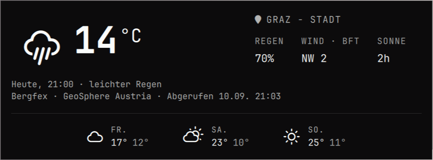

# Bergfex Wetter für Omarchy

Omarchy-Bar-Plug-in `io.github.jwm3000.bergfex-weather`, mit dem Wetterfenster des internen
Omarchy-Plug-ins als Grundlage. Benötigt Python 3 (nur Standardbibliothek).



- Linksklick auf das Wettersymbol öffnet das Fenster.
- Auf den Ortsnamen klicken, mindestens drei Zeichen eingeben und einen
  Bergfex-Suchtreffer auswählen. Pfeiltasten und Enter funktionieren ebenfalls.
- Alternativ eine vollständige `https://www.bergfex.at/…/wetter/`-Adresse eingeben.
- Mittelklick aktualisiert sofort, Rechtsklick öffnet die Bergfex-Seite.
- Klick auf die große Temperatur blendet den regionalen Wetterbericht für heute
  unterhalb der Vorhersage ein oder aus. Der Text stammt von der gewählten
  Bergfex-Ortsseite und wird zusammen mit den Wetterdaten aktualisiert.
- Escape schließt die Ortsauswahl bzw. das Fenster.

Das Fenster zeigt Bergfex' aktuelle stündliche Prognose, Regenwahrscheinlichkeit,
Tageswind in Beaufort, Sonnenstunden und die nächsten drei Tage. Die
Aktualisierung erfolgt alle 15 Minuten; der Abrufzeitpunkt steht im Fenster.
Gespeicherte Daten werden bei Netzwerkfehlern ausdrücklich als veraltet markiert.
Ein neuer Ort wird erst nach erfolgreichem Laden gespeichert.

Standort: `$XDG_STATE_HOME/omarchy/bergfex-weather/location.json`
(Standard: `~/.local/state/omarchy/bergfex-weather/location.json`).
Cache: `$XDG_CACHE_HOME/omarchy/bergfex-weather/`.

## Installation

```sh
omarchy plugin add https://github.com/jwm3000/omarchy-bergfex-weather --enable
```

Danach auf das Wettersymbol und „Ort auswählen“ klicken. Das bisherige interne
Wetter-Widget bleibt erhalten; bei Bedarf in den Bar-Einstellungen deaktivieren.
Das Plug-in selbst verändert keine Bar- oder Systemeinstellungen.

Alternativ den Repositoryinhalt nach
`~/.config/omarchy/plugins/io.github.jwm3000.bergfex-weather/` kopieren und
`omarchy-shell shell rescanPlugins` sowie
`omarchy plugin enable io.github.jwm3000.bergfex-weather` ausführen.

## Deinstallation

```sh
omarchy plugin remove io.github.jwm3000.bergfex-weather
```

Optional den gespeicherten Standort unter
`~/.local/state/omarchy/bergfex-weather/` und den Cache unter
`~/.cache/omarchy/bergfex-weather/` löschen (bzw. die entsprechenden
XDG-Verzeichnisse). Zum internen Wetter zurückkehren:
`omarchy plugin enable omarchy.weather`.

## Abhängigkeiten und Datenzugriff

Omarchy mit Quickshell-Plug-in-Unterstützung, Python 3 (nur Standardbibliothek). Ausgehende HTTPS-Anfragen gehen an `www.bergfex.at`: Der eingegebene
Suchtext wird an die öffentliche Ortssuche geschickt; die gewählte Wetterseite
wird für die Prognose abgerufen. Rechtsklick öffnet diese Seite im Standardbrowser.
Keine Anmeldung, kein API-Schlüssel, keine zusätzlichen Python-Pakete und keine
Administratorrechte erforderlich. Schreibzugriffe sind auf den eigenen Standort
und Wettercache in den oben genannten XDG-Verzeichnissen beschränkt.

## Ressourcenlimits

Der HTTPS-Abruf verwendet einen begrenzten Python-Stream: höchstens 1 MiB
übertragener Body und 2 MiB nach gzip-Dekomprimierung. Gzip-Ausgabe wird bereits
im Dekompressor begrenzt; fehlende oder falsche Content-Length-Angaben umgehen
die Limits nicht. Andere Inhaltskodierungen, Weiterleitungen, unvollständige
oder verkettete gzip-Streams werden verworfen. HTML ist auf 30.000 Elemente
und eine Verschachtelungstiefe unter 96 begrenzt.

Cache-Dateien werden bis 256 KiB, Standortdateien bis 16 KiB gelesen. Alle
Pfadkomponenten werden ohne Symlink-Verfolgung geöffnet. Vor dem Lesen wird am
geöffneten Dateideskriptor geprüft, dass die Datei regulär ist und dem aktuellen
Benutzer gehört. Auch während des Lesens wachsende Dateien bleiben begrenzt.

## Entwicklung

`python3 -m unittest -v` prüft Parser, Suche, Cache und Fehlerfälle.
`omarchy plugin validate .` prüft das Manifest.
QML wird in der laufenden Omarchy-Shell geprüft; ein eigenständiger Qt-6-qmllint-Lauf benötigt zusätzlich die von Quickshell bereitgestellten `qs.*`-Importe.

Der Adapter liest die öffentliche Bergfex-Websuche und das HTML der Wetterseite;
er nutzt keine garantierte öffentliche Wetter-API. Änderungen am Seitenaufbau
können Anpassungen erfordern. Unterstützt wird die Seitenstruktur mit
`forecast-current` und `forecast9d-container`; andere Seiten melden einen Fehler.
Keine Kontodaten oder API-Schlüssel erforderlich.

UI-Grundlage: Omarchy (`BarWidget.qml`, `Panel.qml`), https://github.com/omacom/omarchy.
Wetterdaten: https://www.bergfex.at/; Quellenangabe wird aus der Wetterseite übernommen.

## Lizenz

Der Plug-in-Code steht unter der [MIT-Lizenz](LICENSE). Die übernommenen
Omarchy-UI-Teile unterliegen ebenfalls MIT; der ursprüngliche Copyright-Hinweis
ist in der Lizenz enthalten. Wetterdaten und Bergfex-Marken sind davon nicht
umfasst. Dies ist ein unabhängiges Community-Plug-in, kein offizielles
Bergfex-Produkt.
